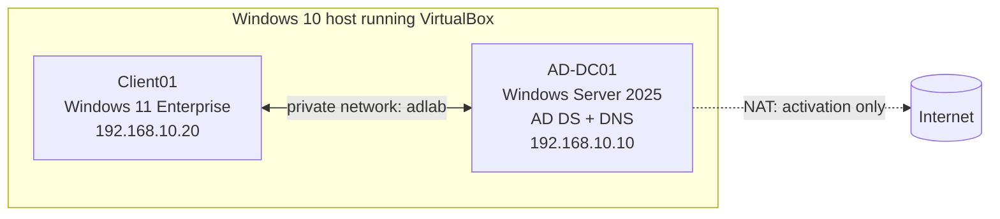
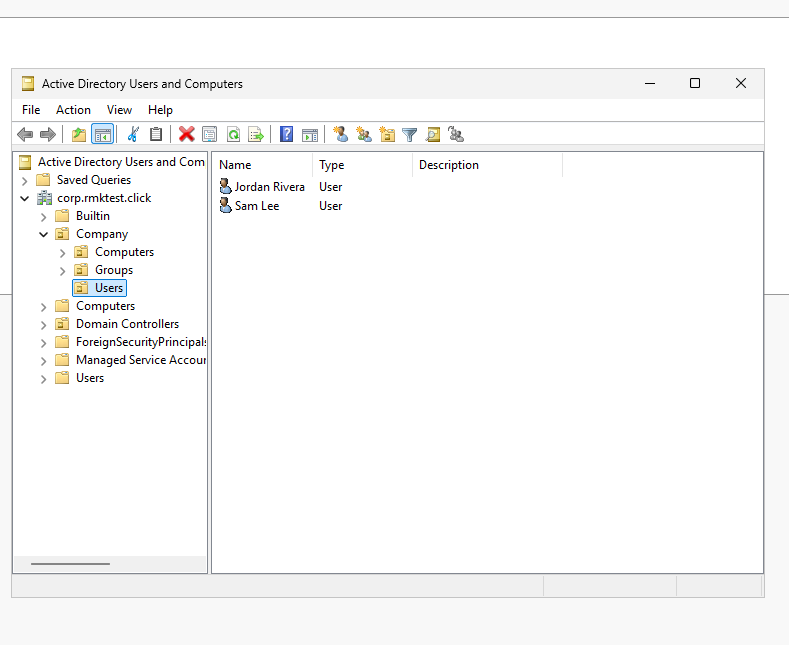
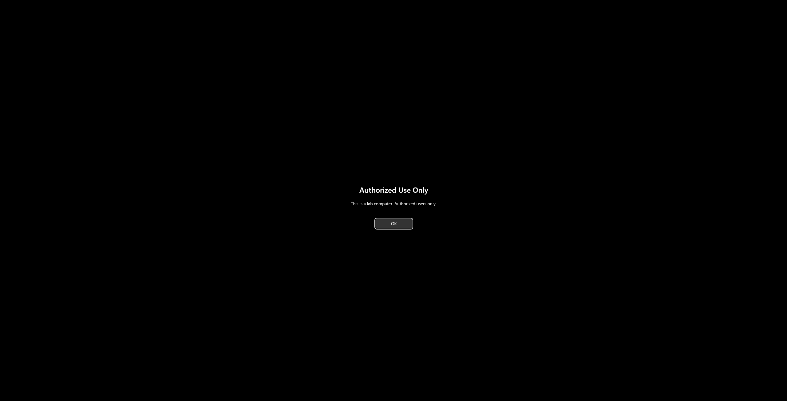
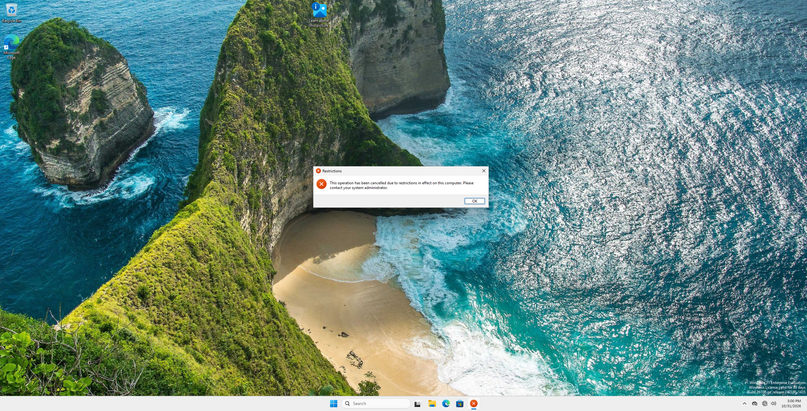
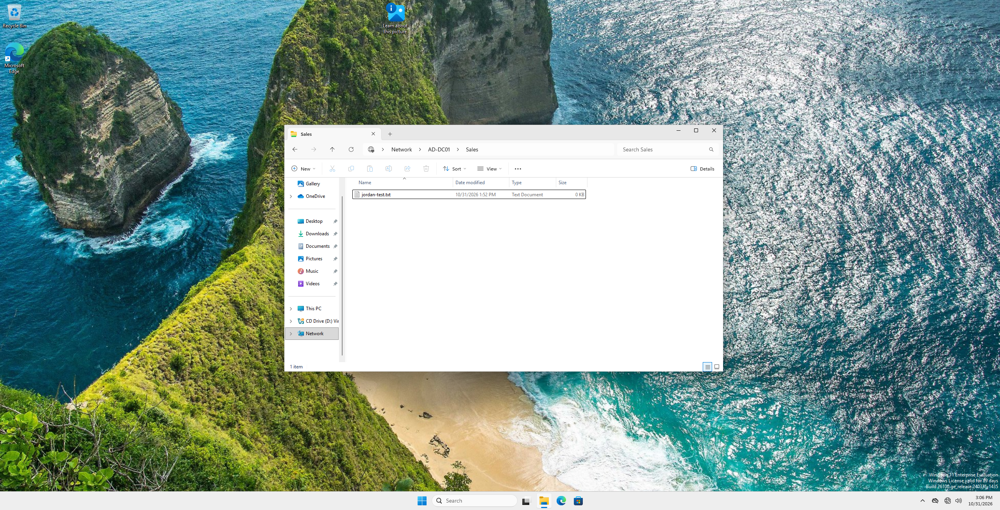
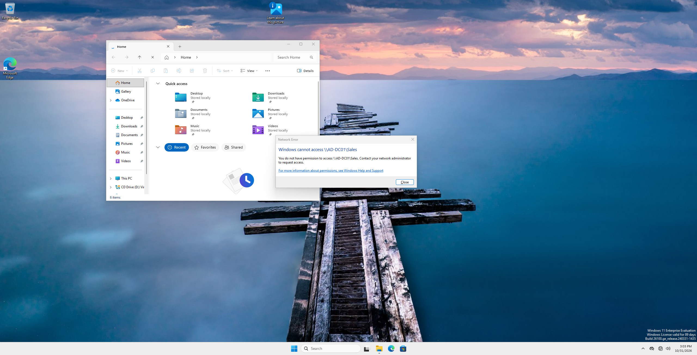
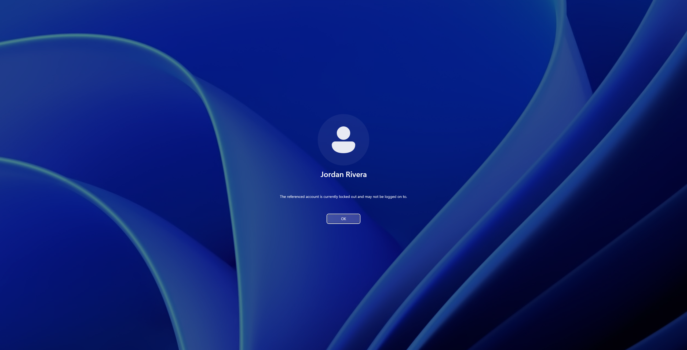
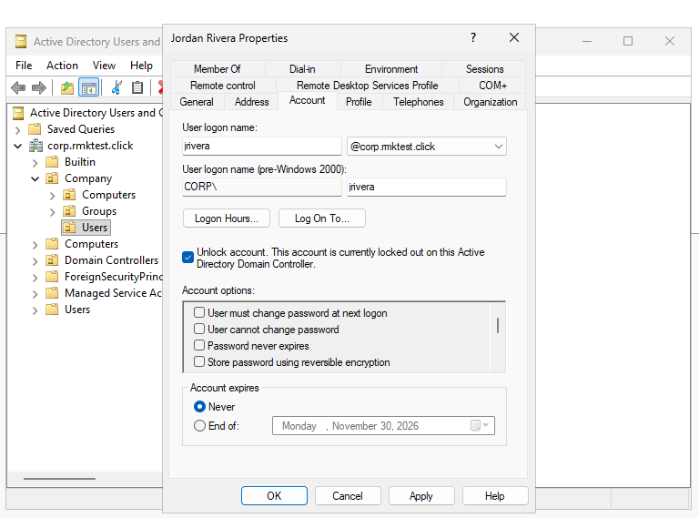

# Active Directory Home Lab

A small Active Directory setup in VirtualBox: one Windows Server domain controller and one Windows 11 laptop joined to a domain. I built it to practice everyday help desk work: creating users, resetting passwords, unlocking accounts, fixing "access denied" tickets, and pushing rules with Group Policy.

Update: this lab was later extended in my Help Desk in a Box project, where I worked five tickets against it: a new hire (Casey Nguyen), an offboarding (Sam Lee’s account disabled), and a password reset. The environment described above is its state at the end of this project.

## Architecture



## The setup

| Machine | OS | Role | Specs |
|---|---|---|---|
| AD-DC01 | Windows Server 2025 Standard Evaluation (Desktop Experience) | Domain controller, DNS, file share | 4 GB RAM, 2 vCPU, 50 GB disk |
| Client01 | Windows 11 Enterprise Evaluation | Employee laptop | 4 GB RAM, 2 vCPU, 80 GB disk |

- **Domain:** `corp.rmktest.click` (NetBIOS name `CORP`)
- **Hypervisor:** VirtualBox 7.2.8
- **Network:** both VMs share a private internal network with fixed addresses. The server has a second NAT adapter for activation, and Client01 is internal-only.

```
corp.rmktest.click
└─ Company
   ├─ Users        (Jordan Rivera, Sam Lee)
   ├─ Computers    (CLIENT01)
   └─ Groups       (Sales-Team)
```

## What I built

- Promoted the server to a domain controller with a new forest and checked its health with `dcdiag`
- Joined Client01 to the domain and moved its computer account into the Computers OU
- **Two Group Policies:**
  - `Logon-Banner` is a computer rule that shows a warning before sign-in
  - `Lock-Control-Panel` is a user rule that blocks Settings for users in the Users OU
- **A restricted share:** `\\AD-DC01\Sales` is open to the `Sales-Team` group only. Share permissions are open, and the real restrictions are NTFS permissions assigned to the group, not to individual people.
- **Account lockout:** 5 failed attempts locks an account for 15 minutes

## Help desk tickets I practiced

| Ticket | What I did |
|---|---|
| "I forgot my password" | Reset it and forced a change at next sign-in |
| "Someone left the company" | Disabled the account instead of deleting it |
| "My account is locked" | Locked Jordan out on purpose, then unlocked him |
| "I can't open the Sales folder" | Confirmed the group membership and permissions. Jordan (in `Sales-Team`) got in, and Sam (not in it) was denied. |

## Screenshots

**Company OU structure and users**



**Computer rule: sign-in banner (Logon-Banner GPO)**



**User rule: Control Panel blocked (Lock-Control-Panel GPO)**



**Group-based file permissions on the Sales share**





**Account lockout and unlock**





## Lessons learned

- **A second network card confused DNS.** The server was publishing its NAT address (and an IPv6 one) to the company phone book, and Client01 couldn't reach them. I removed the stale records, unbound IPv6 from the NAT card, and verified with `nslookup`.
- **Early `dcdiag` failures weren't real.** Right after promotion, a few tests flagged startup errors. A targeted `dcdiag /test:ridmanager` passed, so they were noise.
- **Group Policy has two halves.** `gpresult /r` lists user rules and computer rules separately, and a computer rule won't show in the user section.
- **Account lockout is off by default,** and it only applies to domain accounts when set in the Default Domain Policy.
- **Rename a domain-joined computer from the computer itself,** not from the server, so both sides stay in sync.
- **I took VM snapshots before every risky step,** and they paid off.

## Limitations

- The domain controller doubles as the file server. Real companies keep those separate for security.
- My host CPU isn't on Windows 11's support list, so I bypassed that check inside the VM. That's fine for a lab and wrong for production.
- Evaluation licenses expire (180 days for Server, 90 for Windows 11).
- One domain controller, so no redundancy or backups.
- All passwords were throwaway lab passwords, and none are in this repo.

## Next ideas

- Create users in bulk with PowerShell
- Map the Sales share automatically with Group Policy
- Add a second domain controller
